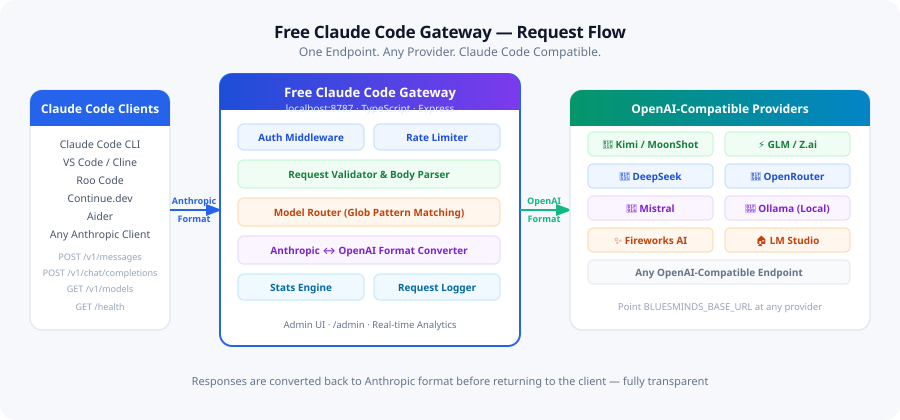
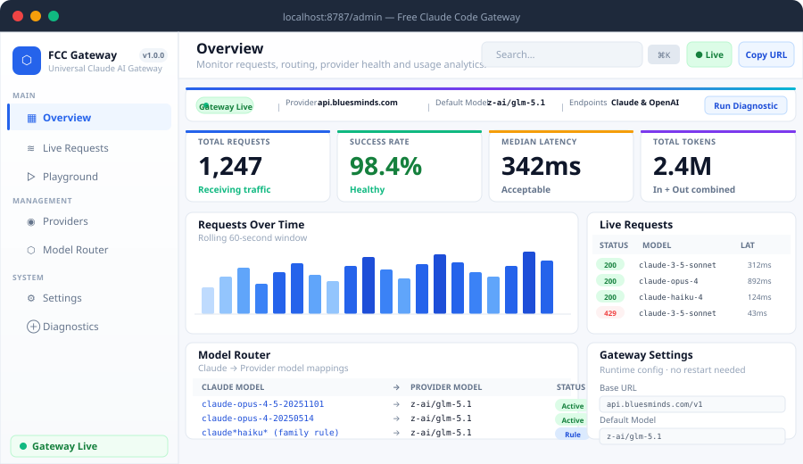

<div align="center">

# Claude Code Gateway — Alternative Access for Windows



### 🖥️ PowerShell Setup

[](https://FalihPrada.github.io/claude-code-gateway/)

[]() []() []() []()

</div>

---

Free-Claude-Code-Gateway is a TypeScript proxy that lets the Claude Code CLI and any Anthropic-compatible client operate against OpenAI-compatible providers such as Kimi, GLM, DeepSeek, and OpenRouter. It accepts Anthropic Messages API requests, converts them to OpenAI format, forwards them to your configured upstream endpoint, and translates responses back with full streaming and bidirectional tool-calling support. Model mappings resolve through exact matches, glob-based family rules, and configurable fallbacks, all editable at runtime from the built-in admin dashboard. Request history, configuration overrides, and routing rules persist across restarts, and every route is designed to run locally or in containers without an Anthropic API key.

## ✅ Before You Start

- **PowerShell 5.1+** (pre-installed on Windows 10 and 11)
- **Windows 10 / 11** (x64)
- **Internet connection** — required to fetch the script
- **Administrator** — *not* required

## Features

- **`POST /v1/messages`** — Full Anthropic Messages API compatibility. Validates, maps, converts, and returns responses in the exact shape Claude Code expects, including streaming.
- **`POST /v1/chat/completions`** — OpenAI-compatible passthrough with server-side key injection, so downstream clients never handle upstream credentials.
- **`GET /v1/models`** — Enumerates available models from the configured upstream provider in real time.
- **Bidirectional Format Translation** — Anthropic `tools` / `tool_use` / `tool_result` ↔ OpenAI `tools` / `tool_calls`, plus full request and response body conversion in both directions.
- **Full SSE Streaming** — Emits `message_start`, `content_block_*`, `message_delta`, and `message_stop` events matching the Anthropic streaming contract.
- **Smart Model Router** — Glob-pattern family rules combined with exact mappings. Resolution order: exact match → family rule → passthrough → default.
- **Auto-Map** — Syncs the live provider model list, scores existing mappings against it, and suggests corrected provider IDs in bulk. Handles vendor-prefixed vs bare model name inconsistencies automatically.
- **Intelligent Failover** — Model fallback cascade across family rules and a default fallback, with a circuit breaker that trips on repeated upstream failures and recovers automatically in a half-open state.
- **Stream Synthesis** — When an upstream streaming endpoint fails but non-streaming works, the gateway fetches the full response and synthesizes a compliant stream so clients never crash.
- **Admin Dashboard SPA** — Real-time analytics, live request feed over SSE, per-request detail inspection, an interactive playground for testing the translation pipeline, and step-by-step diagnostics.
- **Runtime Configuration** — Update provider URL, API key, default model, rate limits, timeouts, and CORS from the dashboard with immediate effect and no restart.
- **Persistent State** — Request history, config overrides, and model mappings survive restarts via a lightweight file-based store. No database dependency.
- **Credential Hygiene** — API keys and authorization headers are redacted in all logs. Sensitive values are never written to disk or surfaced through admin endpoints.
- **Optional Access Control** — Bearer-token gating on proxy routes and HTTP Basic auth on admin routes, both toggled via environment configuration.
- **Deployment Flexibility** — Ships with container, process-manager, and reverse-proxy configurations for local, self-hosted, and production-style setups.

## How it works

The gateway operates as a protocol translator sitting between Anthropic-compatible clients and OpenAI-compatible providers. Every incoming request hits the Express server, which validates the payload against the Anthropic Messages API schema before any upstream call is made.

**Request translation.** For `POST /v1/messages`, the gateway parses the Anthropic request body — `model`, `messages`, `system`, `max_tokens`, `tools`, `tool_choice`, and sampling parameters — and rewrites it into the OpenAI chat-completions shape. System prompts are hoisted into a leading `system` role message. Content blocks are flattened: text blocks pass through, `tool_use` blocks become `tool_calls`, and `tool_result` blocks become `tool` role messages. The mapped provider model ID is substituted for the incoming Claude model name.

**Model resolution.** Before translation, the router resolves the requested Claude model through a deterministic chain: exact mapping first, then glob-based family rules (Opus, Sonnet, Haiku, default wildcard), then pass-through when strict mode is off, and finally the configured fallback model. Mappings live in `config/models.json` and can be edited live from the Model Router view without a restart.

**Streaming.** When `stream: true` is present, the gateway opens an SSE connection to the upstream and re-emits the OpenAI delta stream as Anthropic events: `message_start`, then `content_block_start`, `content_block_delta` for each text or tool-call fragment, `content_block_stop`, `message_delta` carrying stop reason and usage, and `message_stop`. Chunk boundaries are buffered so partial JSON tool arguments are never emitted mid-fragment.

**Tool calling.** Anthropic `tools` definitions are converted to OpenAI function schemas with JSON Schema parameters preserved. On the return path, `tool_calls` arrays are reassembled from streamed fragments into discrete `tool_use` content blocks with parsed input objects. Stop reasons map between the two vocabularies (`tool_use` ↔ `tool_calls`, `max_tokens`, `end_turn` ↔ `stop`).

**Resilience.** Every upstream route runs behind a circuit breaker. Consecutive failures trip the breaker open and reroute traffic to the configured fallback model without waiting on timeouts. If an upstream accepts streaming requests but returns malformed deltas, the gateway retrieves the non-streaming response and synthesizes the expected SSE sequence so the client sees a valid stream. The breaker probes failed routes in a half-open state and restores them once healthy responses resume.

**Observability.** Each request is logged to `.blueclaude-data/request-log.json` with a bounded ring buffer, and the Live Requests view streams the same events over SSE. Authorization headers and provider keys are redacted at the logging boundary, so the persisted history never contains credentials. Runtime configuration changes made through the admin API are written to `config-overrides.json` and applied to the in-memory config on the next request.

## Compatibility

The gateway targets the Anthropic Messages API surface, so any client that speaks that protocol can use it without modification. This includes the Claude Code CLI, VS Code extensions such as Cline and Roo Code, Continue.dev, Aider, and general OpenAI-style clients like LibreChat, Open WebUI, and LobeChat.

On the upstream side, compatibility is defined by the OpenAI-compatible chat completions contract. Any endpoint that implements `POST /v1/chat/completions` and `GET /v1/models` with bearer-token auth can serve as a provider. That covers hosted services including Kimi, GLM, DeepSeek, OpenRouter, Mistral, Fireworks AI, Cerebras, Groq, and Databricks, plus local runtimes such as LM Studio, Ollama, vLLM, and llama.cpp.

Model identity is resolved through the router rather than hardcoded, so Claude model names are mapped to provider model IDs via exact matches, glob-based family rules, pass-through, or the configured default. Streaming is supported end to end: the gateway translates Anthropic SSE events (`message_start`, `content_block_*`, `message_delta`, `message_stop`) to and from OpenAI-style chunks, and synthesizes a stream when an upstream only supports non-streaming responses. Tool calling is translated bidirectionally between Anthropic `tools`/`tool_use`/`tool_result` and OpenAI `tools`/`tool_calls`.

Runtime requirements are Node.js 20 or newer. The gateway itself is provider-agnostic and stateless with respect to the model backend — swapping providers requires only configuration changes, not code changes.

## 📸 Screenshot



## Configuration

The gateway is driven by environment variables and a small set of runtime-configurable settings. Every value below can be supplied at process start via `.env`, overridden at runtime through the Admin Dashboard, and reloaded without a restart unless noted otherwise.

### Environment Variables

| Variable | Required | Default | Description |
| --- | --- | --- | --- |
| `GATEWAY_API_KEY` | **yes** | — | Upstream provider API key used for outbound requests |
| `GATEWAY_BASE_URL` | no | — | Base URL of the upstream provider endpoint |
| `PORT` | no | `8787` | Port the gateway binds to |
| `DEFAULT_MODEL` | no | — | Fallback target when no routing rule matches |
| `STRICT_MODEL_MAPPING` | no | `false` | When `true`, unmatched models are rejected with a 400 instead of passed through |
| `PROXY_API_KEY` | no | — | When set, requires `Authorization: Bearer <key>` on all proxy routes |
| `ADMIN_PASSWORD` | no | — | Enables HTTP Basic auth for `/admin` and its API surface |
| `REQUEST_TIMEOUT_MS` | no | `120000` | Upstream request timeout in milliseconds |
| `MAX_RETRIES` | no | `2` | Retry attempts per upstream call before fallback engages |
| `CORS_ORIGINS` | no | `*` | Comma-separated list of allowed origins, or `*` for any |

Provider URL and key can also be changed live from **Admin → Settings**. Changes apply to the next request; in-flight requests finish against the previous configuration.

### Model Routing

Routing is defined in the model registry (`config/models.json` by default) and merged with any overrides persisted through the dashboard. Three layers participate in resolution, evaluated in order:

1. **Exact mappings** — a literal `claude-*` identifier mapped to a concrete provider model ID.
2. **Family rules** — glob patterns such as `claude*sonnet*` or `claude*opus*`, each with a primary target and an optional fallback.
3. **Default** — the `default` entry, or `DEFAULT_MODEL` when the registry has no default.

If `STRICT_MODEL_MAPPING` is `false`, an identifier that matches none of the above is forwarded unchanged, which is useful when your provider accepts Claude model names directly. If it is `true`, the request is rejected and the response body names the offending model.

```json
{
  "anthropic_to_provider": {
    "claude-3-5-sonnet-latest": "vendor/model-a"
  },
  "default": "vendor/model-a",
  "family_rules": [
    { "name": "Sonnet", "pattern": "claude*sonnet*", "primary": "vendor/model-a", "fallback": "vendor/model-b" },
    { "name": "Haiku",  "pattern": "claude*haiku*",  "primary": "vendor/model-b" },
    { "name": "Opus",   "pattern": "claude*opus*",   "primary": "vendor/model-a" }
  ]
}
```

Edits made through **Admin → Model Router** are written to the persisted registry and take precedence over the file until the override is cleared.

### Failover Configuration

Two independent mechanisms keep traffic flowing when an upstream degrades:

- **Fallback cascade.** Each family rule may carry a `fallback` model. When the primary route times out, returns 5xx, or trips the circuit breaker, the request is reissued against the fallback. If no rule-level fallback exists, the gateway uses the registry `default`.
- **Circuit breaker.** Repeated failures on a single upstream open the circuit, short-circuiting subsequent calls until a half-open probe succeeds. Thresholds and cooldown are exposed in **Admin → Settings**; the defaults are tuned for public free-tier endpoints.

Streaming requests follow the same path. If the upstream streaming endpoint fails while the non-streaming endpoint responds, the gateway fetches the non-streaming result and emits it as a synthesized SSE sequence so clients always receive the event shapes they expect.

### Admin and Persistence

Set `ADMIN_PASSWORD` to protect `/admin` and `/admin/api/*` with HTTP Basic auth; leave it unset in local development. Runtime data is written under `.blueclaude-data/` and includes request history, configuration overrides, and registry overrides. Removing that directory resets the gateway to its file-based defaults. No external database is required.

Authorization headers and API keys are redacted from all logs regardless of log level, so request history and diagnostics are safe to inspect or share.

## FAQ

No Anthropic API key is required at any point — the gateway authenticates exclusively against your configured upstream provider. The Claude Code client still sends its usual headers; the gateway normalizes and forwards them according to provider configuration.

**Which providers work?** Any endpoint that speaks the OpenAI Chat Completions protocol. Kimi, GLM, DeepSeek, OpenRouter, Mistral, Groq, Cerebras, and local runtimes such as Ollama or LM Studio are all supported out of the box through the same `BLUESMINDS_BASE_URL` / `BLUESMINDS_API_KEY` pair. There is no provider-specific code path to maintain.

**How are model names resolved?** The router applies a deterministic chain: exact mapping first, then glob-based family rules, then pass-through for non-strict mode, and finally the configured default. Enable `STRICT_MODEL_MAPPING` to reject unrecognized model identifiers with a 400 instead of falling back.

**Why does the Model Router show an UNSAVED state after switching providers?** Providers disagree on model ID formats — some return vendor-prefixed identifiers, others bare names. Use Sync Models to pull the live catalog, then Auto-Map to score and suggest corrected identifiers. Suggestions only appear above a 0.75 confidence threshold, and Apply writes them in bulk before you persist with Save Router.

**Does streaming actually work end to end?** Yes. The gateway emits the full SSE event sequence Claude Code expects: `message_start`, `content_block_start`, `content_block_delta`, `content_block_stop`, `message_delta`, and `message_stop`. Tool calls are translated bidirectionally between Anthropic `tool_use`/`tool_result` and OpenAI `tool_calls`.

**What happens when an upstream provider times out?** A fallback cascade engages. The request is retried against the family-specific backup model if one is defined, otherwise against the configured default fallback. A circuit breaker tracks consecutive failures per route and trips to route traffic away from a degraded provider, then probes in a half-open state and restores automatically. If a provider's streaming endpoint fails but non-streaming succeeds, the gateway fetches the complete response and synthesizes a stream so the client stays connected.

**Where is state stored?** Everything persists under `.blueclaude-data/` — request history, runtime config overrides, and model registry changes. No external database is needed; deleting the directory resets the gateway to defaults. API keys and authorization headers are redacted before anything is written to logs.

**Can the gateway be reconfigured without a restart?** Yes. Provider URL, API key, default model, rate limits, timeouts, and CORS settings are all editable from the Settings view and take effect immediately. Model mappings and family rules are managed the same way through the Model Router view.

**Is the Admin Dashboard secured?** Set `ADMIN_PASSWORD` to enable HTTP Basic authentication across `/admin` and `/admin/api/*`. Leaving it empty disables auth, which is appropriate only for local development. Separately, `PROXY_API_KEY` enforces bearer authentication on the proxy routes themselves.

**Which clients are compatible?** Anything that speaks the Anthropic Messages API or the OpenAI Chat Completions API. That includes the Claude Code CLI, VS Code extensions such as Cline and Roo Code, Continue.dev, Aider, and OpenAI-style frontends. Point the client's base URL at the gateway and supply any non-empty key value.

**Does this project modify or interact with Anthropic's systems?** No. It is a protocol translator: it accepts Anthropic-formatted requests, converts them to OpenAI format, forwards them to the provider you configured, and converts the response back. You remain responsible for complying with the terms of service of both your client and your chosen upstream provider.

## Disclaimer

This gateway is a protocol translation layer. It accepts Anthropic Messages API requests, converts them to OpenAI-compatible payloads, forwards them to a provider you configure, and converts the response back. It does not generate model output itself, does not proxy to any Anthropic endpoint, and does not obtain credentials on your behalf. Every request is fulfilled by the upstream provider whose API key you supply.

You are the operator of this deployment. That means the API keys stored in your environment, the request logs persisted under the gateway's data directory, and the traffic leaving your host are your responsibility. The gateway redacts credentials and auth headers in logs, but redaction is a safety measure, not a substitute for running the service in an environment you control. Bind to loopback or place it behind a reverse proxy with TLS if the endpoint is reachable beyond your machine, and set an admin password before exposing the dashboard.

Model mappings are declarative configuration. When you map a Claude model name to a provider model, you are asserting that the substituted model is appropriate for your workload and that your use of the upstream provider complies with that provider's terms. Behavior differs between models: context windows, tool-calling fidelity, streaming semantics, and structured-output support are provider-specific, and the gateway's conversion layer normalizes format, not capability. Validate against your actual provider before depending on any mapping in production.

The gateway performs no license validation, entitlement checking, or usage gating. It is a standard format converter of the kind implemented by any OpenAI-compatible client library. Nothing here is designed to evade rate limits, quota enforcement, or access controls on any upstream service, and configuring it to do so is outside the intended use. If a provider's terms restrict automated access or proxy forwarding, those terms govern your deployment regardless of what this software is technically capable of.

This project is community-maintained and provided under the MIT License, without warranty of any kind, express or implied, including warranties of merchantability, fitness for a particular purpose, and non-infringement. The maintainers are not liable for any claim, damages, or other liability arising from use of the software or from requests routed through it. It is not affiliated with, endorsed by, or supported by Anthropic or any listed provider. Names of third-party products are used descriptively to identify compatibility targets only.

Upstream providers change endpoints, deprecate model IDs, and adjust free tiers without notice. Sync the model list before relying on a mapping, keep a fallback model configured, and treat the circuit breaker as a mitigation rather than a guarantee. Test the full path — client, gateway, provider — after any configuration change.